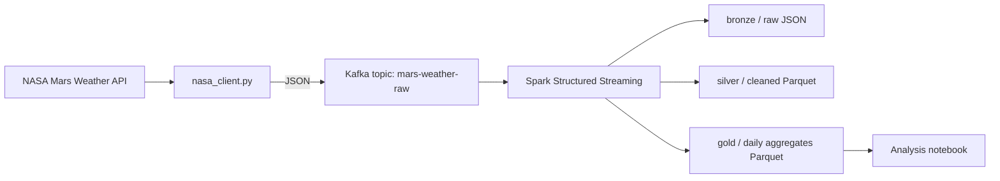

# Mars Planet Weather Streaming

Real-time streaming pipeline for Mars weather data, built with PySpark Structured Streaming, Kafka, and a medallion (bronze / silver / gold) architecture.

The project fetches Mars weather from NASA's public APIs (InSight-style weather service), streams each observation through Kafka, and processes it with Spark into clean, analysis-ready tables. It is designed as a portfolio project for data engineering roles: small enough to run locally, close enough to production patterns to talk about in an interview.

## What it does

- Pulls Mars weather observations (sol, temperature, pressure, wind) from NASA's API
- Publishes each observation to a Kafka topic
- Streams from Kafka with Spark Structured Streaming
- Writes raw data to bronze, cleaned data to silver, and daily aggregates to gold
- Includes a notebook for quick exploration of the gold layer

If no NASA API key is available, the client falls back to the bundled sample data in `data/sample_mars_weather.json` so the pipeline still runs end to end.

## Architecture



### Medallion layers

| Layer | Format | Contents |
|-------|--------|----------|
| Bronze | JSON / Parquet | Raw API payloads, as received, plus ingestion timestamp |
| Silver | Parquet | Typed, deduplicated, validated records with derived Celsius fields |
| Gold | Parquet | One row per sol: min / max / avg temperature, pressure, wind, observation count |

## Tech stack

- Python 3.10+
- Apache Spark 3.5 (PySpark Structured Streaming)
- Apache Kafka 3.x (local via Docker Compose)
- NASA InSight Weather API (with sample-data fallback)
- Parquet + Delta-style partitioning by sol
- Docker Compose for local infra

## Project structure

```
mars-planet-weather-streaming/
├── README.md
├── requirements.txt
├── docker-compose.yml
├── .gitignore
├── data/
│   └── sample_mars_weather.json   # Fallback data when no API key is set
├── notebooks/
│   └── mars_analysis.ipynb        # Explore the gold layer
└── src/
    ├── config.py                  # All env-driven settings in one place
    ├── nasa_client.py             # NASA API client + sample fallback
    ├── producer.py                # Polls NASA and publishes to Kafka
    └── streaming_job.py           # Bronze -> Silver -> Gold Spark job
```

## Setup

### 1. Clone and install

```bash
git clone https://github.com/y2ksayed/mars-planet-weather-streaming.git
cd mars-planet-weather-streaming
python -m venv .venv
source .venv/bin/activate
pip install -r requirements.txt
```

### 2. Set your NASA API key (optional)

Get a free key at https://api.nasa.gov, then:

```bash
export NASA_API_KEY="your_key_here"
```

Without a key, the producer uses `DEMO_KEY` first and then the local sample file, so you can still demo the pipeline.

### 3. Start Kafka and Spark

```bash
docker compose up -d
docker compose ps
```

This starts Zookeeper, Kafka (on `localhost:9092`), and Spark master/worker. If you already have Spark installed locally, you can skip the Spark containers and run the job with your local `spark-submit`.

### 4. Create the Kafka topic

```bash
docker exec -it mars-kafka kafka-topics.sh \
  --create --topic mars-weather-raw \
  --bootstrap-server localhost:9092 \
  --partitions 3 --replication-factor 1
```

## How to run

Run the producer and the streaming job in two terminals.

**Terminal 1 — producer:**

```bash
export NASA_API_KEY="your_key_here"  # optional
python src/producer.py --interval-seconds 60 --once
```

Flags:

- `--interval-seconds` — how often to poll NASA (default: 60)
- `--once` — fetch once and exit, useful for a quick demo
- `--use-sample` — force the bundled sample data instead of the API

**Terminal 2 — Spark streaming job:**

```bash
spark-submit \
  --packages org.apache.spark:spark-sql-kafka-0-10_2.12:3.5.0 \
  src/streaming_job.py \
  --kafka-bootstrap-servers localhost:9092 \
  --input-topic mars-weather-raw \
  --output-base data/output
```

The job writes to:

- `data/output/bronze/`
- `data/output/silver/`
- `data/output/gold/`

## Sample output

Silver record (one observation, cleaned):

```json
{
  "sol": 1094,
  "terrestrial_date": "2023-01-15",
  "air_temp_avg_c": -62.4,
  "air_temp_min_c": -81.1,
  "air_temp_max_c": -18.9,
  "pressure_pa": 724.5,
  "wind_speed_ms": 5.8,
  "ingested_at": "2023-01-15T12:00:00Z"
}
```

Gold record (one row per sol):

```json
{
  "sol": 1094,
  "terrestrial_date": "2023-01-15",
  "avg_temp_c": -62.4,
  "min_temp_c": -81.1,
  "max_temp_c": -18.9,
  "avg_pressure_pa": 724.5,
  "avg_wind_ms": 5.8,
  "observation_count": 1
}
```

## Configuration

All settings live in `src/config.py` and are overridable with environment variables:

| Variable | Default | Description |
|----------|---------|-------------|
| `NASA_API_KEY` | `DEMO_KEY` | NASA API key |
| `KAFKA_BOOTSTRAP_SERVERS` | `localhost:9092` | Kafka brokers |
| `KAFKA_TOPIC` | `mars-weather-raw` | Input topic |
| `OUTPUT_BASE` | `data/output` | Bronze / silver / gold root |
| `CHECKPOINT_DIR` | `data/checkpoints` | Spark checkpointing |

## Testing the pieces without Docker

```bash
# Fetch and print one observation (uses sample data if no key)
python src/nasa_client.py

# Produce one message to Kafka (requires Kafka running)
python src/producer.py --once

# Run the notebook after the gold layer exists
jupyter notebook notebooks/mars_analysis.ipynb
```

## Design decisions

- **Why Kafka in the middle?** The NASA API is a polling source. Putting Kafka between the poller and Spark decouples ingestion from processing, gives replay, and matches how most production streaming systems are built.
- **Why medallion?** Bronze keeps the raw payload for debugging. Silver is where validation and typing happen. Gold is the small, trusted table analysts actually query.
- **Why checkpointing?** Spark Structured Streaming needs a checkpoint directory to recover offsets and state after a restart. The job fails fast if the checkpoint path is not writable.
- **Why fallback data?** NASA's InSight lander is no longer sending new weather data, and the API can be rate-limited. The sample file keeps the demo reproducible.

## Future work

- [ ] Add Perseverance MEDA-style data as a second source
- [ ] Add data quality checks with Great Expectations or Soda
- [ ] Publish gold to Postgres / DuckDB for dashboarding
- [ ] Add Terraform for MSK + EMR deployment
- [ ] Add unit tests for the silver cleaning logic

## Data source

NASA InSight Mars Weather Service — https://api.nasa.gov

InSight data is historical. This project treats the API as a batch source that is re-polled and streamed, which is a common pattern when backfilling a streaming pipeline from a REST API.

## License

MIT
